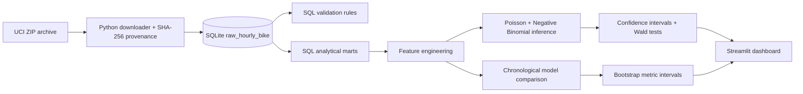

# MetroCycle — Bike Demand Statistical Modeling

MetroCycle is an end-to-end statistical modeling portfolio project built on the published [UCI Bike Sharing dataset](https://archive.ics.uci.edu/dataset/275/bike+sharing+dataset). It asks a practical operations question:

> How are hourly bike rentals associated with weather, seasonality, holidays, and time patterns—and how accurately can demand be forecast on a future chronological holdout?

The project deliberately separates **statistical inference** from **predictive performance**. A Negative Binomial generalized linear model provides interpretable incidence-rate ratios and robust confidence intervals, while regularized and tree-based models test forecasting accuracy.

## What the project demonstrates

- Reproducible ingestion of a published, licensed dataset with SHA-256 provenance
- SQL source-to-analytical transformations and eight automated quality checks
- Poisson overdispersion testing and Negative Binomial count regression
- Robust standard errors, confidence intervals, joint Wald tests, and Holm multiplicity adjustment
- Multicollinearity and residual-autocorrelation diagnostics
- Leakage-safe feature engineering and chronological validation
- Baseline, log-linear, Poisson, Negative Binomial, and Gradient Boosting comparison
- Bootstrap 95% confidence intervals for holdout metrics
- Interactive Streamlit dashboard and predictive scenario explorer
- pytest coverage for transformations, leakage controls, metrics, reconciliation, and time splitting

## Headline results

The source file contains **17,379 hourly observations** from 2011–2012. The final 20% of observations—August 7 through December 31, 2012—are retained as an untouched chronological holdout.

| Model | Holdout MAE | Holdout RMSE | R² |
|---|---:|---:|---:|
| Gradient Boosting | 41.38 | 67.99 | 0.905 |
| Regularized Poisson | 79.81 | 113.53 | 0.735 |
| Log-linear Ridge | 80.43 | 117.43 | 0.716 |
| Negative Binomial GLM | 80.62 | 122.45 | 0.692 |
| Hour/workday baseline | 101.55 | 144.92 | 0.568 |

Statistical findings from the adjusted Negative Binomial model:

- The Poisson dispersion ratio is **28.9**, so the equidispersion assumption is not credible.
- Light rain or snow is associated with approximately **40.4% lower expected hourly demand** than clear conditions (IRR 0.596; robust 95% CI 0.571–0.623).
- Holidays are associated with approximately **18.9% lower expected demand** (IRR 0.811; 95% CI 0.763–0.863).
- The temperature relationship is nonlinear and peaks near **26.8°C** in the fitted quadratic specification.
- Residual lag-1 autocorrelation remains high, so this model is not presented as a complete time-series specification.

These are conditional associations, not causal effects.

## Architecture



## Run locally

```bash
python -m pip install -r requirements.txt
python scripts/run_pipeline.py
pytest
streamlit run streamlit_app.py
```

For one-command pipeline, test, and dashboard validation:

```bash
python scripts/ci_validate.py
```

The first command pipeline downloads the official UCI archive, builds `data/processed/metrocycle.db`, executes the SQL checks, fits all models, and writes reproducible analytical outputs. The raw data and generated model artifacts are intentionally excluded from Git.

## Dashboard views

1. **Executive Overview** — demand KPIs, daily trend, hourly profiles, and weather segmentation.
2. **Statistical Inference** — IRR forest plot, robust confidence intervals, and Holm-adjusted hypothesis tests.
3. **Model Diagnostics** — holdout comparison, bootstrap uncertainty, time-series overlays, dispersion, VIF, and residual autocorrelation.
4. **Scenario Explorer** — predictions from three operational models for a user-defined hour and weather scenario.
5. **Data Quality** — SQL rules, source attribution, validation design, and interpretation limits.

## Repository structure

```text
├── data/                  # ignored raw and processed data locations
├── docs/                  # SAP, model card, dictionary, and executive brief
├── outputs/               # ignored generated metrics, predictions, and models
├── scripts/               # download, database build, and orchestration
├── sql/                   # schema, transformations, and quality rules
├── src/                   # features, data access, modeling, and bootstrap logic
├── tests/                 # automated unit and integration tests
├── streamlit_app.py       # five-view interactive dashboard
└── requirements.txt
```

## Documentation

- [Statistical analysis plan](docs/statistical_analysis_plan.md)
- [Model card](docs/model_card.md)
- [Data dictionary](docs/data_dictionary.md)
- [Executive recommendation](docs/executive_summary.md)
- [Validation checklist](docs/validation_checklist.md)

## Data source and license

Fanaee-T, H. (2013). *Bike Sharing* [Dataset]. UCI Machine Learning Repository. [DOI: 10.24432/C5W894](https://doi.org/10.24432/C5W894).

The UCI dataset is licensed under [CC BY 4.0](https://creativecommons.org/licenses/by/4.0/). This repository does not commit the downloaded source files; the pipeline retrieves them from UCI and records file hashes. Project code is provided under the MIT License.

## Interpretation boundary

The dataset covers one bike-sharing system in 2011–2012. Results may not transport to current operations, other cities, or materially different fleets. Calendar and weather variables are observational. Scenario outputs are model predictions—not causal policy simulations, capacity guarantees, or real-time forecasts.

